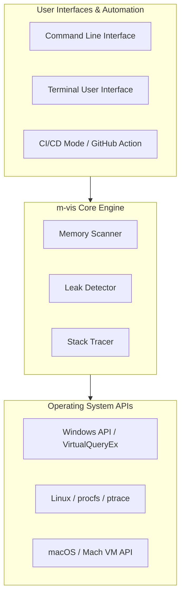
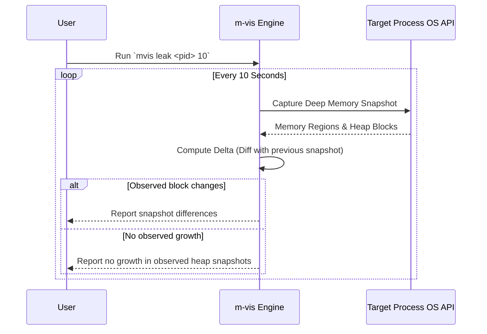

# m-vis: Memory Debugging Made Simple

[](https://github.com/SickleFire/m-vis/actions/workflows/tests.yml)
[](https://opensource.org/licenses/MIT)

Welcome to **m-vis**, a command-line and terminal interface for exploring the memory of running processes.

Use it to inspect memory maps, view heap information exposed by the operating system, compare snapshots, and examine bytes at an address. What m-vis can observe depends on the operating system, process permissions, and the target process's allocator.

It is an exploratory diagnostic tool, not a replacement for runtime memory-safety tools or platform debuggers.

---

## Quick Start

### 1. Installation
For detailed installation instructions, scripts, pre-built binaries, and cargo setup, see [Install.md](Install.md).

Quick automated install:
- **macOS / Linux**:
  ```bash
  curl --proto '=https' --tlsv1.2 -sSf https://raw.githubusercontent.com/SickleFire/m-vis/master/install.sh | sh
  ```
- **Windows (PowerShell)**:
  ```powershell
  iex (iwr -useb https://raw.githubusercontent.com/SickleFire/m-vis/master/install.ps1)
  ```

### 2. Enter the TUI
Experience the interactive memory dashboard immediately:
```bash
mvis tui
```

### 3. Basic CLI Commands
```bash
# Find a target process
mvis list

# Scan process memory maps (replace 'notepad' with your target)
mvis scan notepad -a

# Monitor a process for memory leaks (10 second interval)
mvis leak notepad 10
```

---

## System Architecture

m-vis is built in Rust and provides a common interface over platform-specific memory APIs. The data and level of detail available can differ between operating systems.



---

## Features & Capabilities

- **Process Scanning**: Inspect reported memory regions, mappings, and permissions of active processes.
- **Heap Inspection**: View heap ranges and allocation information where the platform API makes it available. Reported ranges may combine multiple allocations.
- **DLL Tracking**: Monitor and list all dynamic libraries (DLLs/SOs/Dylibs) loaded by a target.
- **Memory Change Monitoring**: Compare heap snapshots over time and highlight observed growth. Growth is a signal to investigate, not by itself proof of a leak; stable snapshots do not prove that a process is leak-free.
- **Leak Delta Chart**: The TUI visualizes observed snapshot changes over time.
- **CI/CD Integration**: Run configured process and memory checks and export reports (JSON/CSV/JUnit) via `mvis ci` and GitHub Actions.
- **Raw Memory Inspection**: Dump and inspect raw hex/ASCII bytes around arbitrary memory addresses in live processes.
- **Pointer Relationship Exploration**: On supported platforms, heap scans look for pointer-like values that fall within reported heap ranges. Results are best-effort and may miss relationships or be unable to determine allocation status.
- **Platform Support**: m-vis has platform-specific implementations for Windows, Linux, and macOS. Capabilities, permissions, and inspection detail vary by platform.

When a pointer edge is identified as targeting a reported freed block, m-vis may attach a sampled stack from the target process at scan time. This is not the historical call site that stored the pointer. Unwinding and symbol resolution depend on platform support, permissions, and available debug symbols. When capture fails, the edge remains in the scan output with a `stack_trace_error` field instead.

Heap APIs may group multiple allocations into one reported range. For pointers whose source and target fall within the same range, the Pointer Tree can show the exact pointer value and source slot as unresolved, because the available heap data cannot establish whether the target allocation is live or freed. Pointer scanning examines up to 64 KiB per reported block, so pointers outside the scanned portion may not be found. Treat pointer-tree results as investigative leads, not a complete inventory of pointers or proof of a use-after-free.

---

## Core Workflows: How Leak Detection Works

The leak workflow compares heap snapshots across time and reports changes in the blocks m-vis can observe. Snapshot differences can help identify growth, but allocator behavior, heap-enumeration limits, and changing workloads can affect the results. A reported increase is not conclusive proof of a leak, and no reported increase does not prove that no leak exists.



---

## macOS Security & Code Signing

On macOS, `mvis` requires the `com.apple.security.cs.debugger` entitlement to inspect other processes due to Hardened Runtime restrictions. Even with `sudo`, inspecting third party apps requires this entitlement.

To build and run `mvis` on macOS:
```bash
# We provide a Makefile that automatically builds and signs the binary ad-hoc
make build

# To run a scan using the Makefile helper:
make run-scan PROCESS=language_server_macos_arm MODE=-a
```
*Note: Apple platform apps (Safari, Finder) and some Hardened Runtime apps (WhatsApp) will remain protected by System Integrity Protection (SIP) even with this entitlement.*

---

## Windows Antivirus False Positives & Execution Warnings

Because `m-vis` is an unsigned, open-source memory utility, Windows Defender or other antivirus software may occasionally flag `mvis.exe` with a behavioral warning (e.g., "Suspicious Behavior" or a SmartScreen block).

### Why does this happen?
To perform memory visualization, `m-vis` must open handles to, inspect, and interact with the memory space of active processes. When an unsigned binary attempts to inspect critical or system-level processes (like `explorer.exe`), heuristic-based security engines flag this behavior because it looks identical to process-injection techniques used by malware. 

The entire source code of this tool is fully transparent, auditable, and open for review.

---

## Detailed Usage & Examples

### Available Commands
```powershell
# visualize memory map
mvis scan notepad.exe -a

# heap stats
mvis scan notepad.exe -h

# detect leaks
mvis leak notepad.exe 10

# run automated CI checks & leak audits
mvis ci --spawn ./my_service --leak-check --max-memory 100M

# dump raw memory bytes
mvis dump notepad.exe 0x7ff123456780 128

# multi sample leak detection
mvis leak-m notepad.exe 10 3

# list processes
mvis list

# open mvis tui
mvis tui
```

---

## Developer Commands & Testing

The project includes comprehensive unit and integration tests to ensure reliability across platforms.

### Run all tests
```bash
cargo test
```

### Run only integration tests
```bash
cargo test --test integration_tests
```

### Run integration tests with elevated privileges
```bash
# On Linux with sudo
sudo cargo test --test integration_tests -- --include-ignored

# On Windows (run terminal as Administrator)
cargo test --test integration_tests -- --include-ignored
```

---

## Status & Roadmap
Early but highly functional. Core scanning and leak detection work on all supported platforms. 
See the [Roadmap](https://github.com/SickleFire/m-vis/issues/24) for what's coming next.

## License
MIT — see [LICENSE](LICENSE.md)
