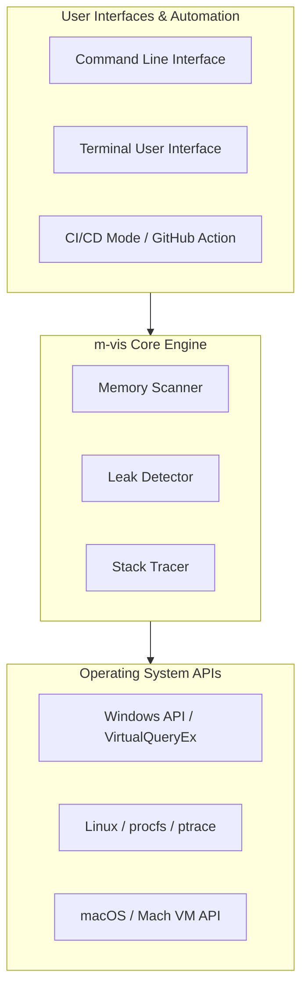
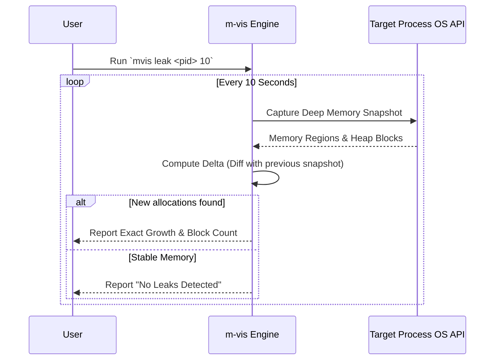

# m-vis: Memory Debugging Made Simple

[](https://github.com/SickleFire/m-vis/actions/workflows/tests.yml)
[](https://opensource.org/licenses/MIT)

Welcome to **m-vis**. Memory debugging for developers who just want answers. Simple. Fast. Works everywhere.

Existing tools are either platform specific (Valgrind, WinDbg) or too complex for quick diagnostics. m-vis gives you deep memory insights with a single command across any platform.

Our design philosophy is built around simplicity and accessibility because **we believe memory debugging should be accessible, not a PhD requirement.**

**"One command. All platforms. No configuration hell."**

---

## Quick Start

### 1. Installation
For detailed installation instructions, scripts, pre-built binaries, and cargo setup, see [Install.md](Install.md).

Quick automated install:
- **macOS / Linux**:
  ```bash
  curl --proto '=https' --tlsv1.2 -sSf https://raw.githubusercontent.com/SickleFire/m-vis/master/install.sh | sh
  ```
- **Windows (PowerShell)**:
  ```powershell
  iex (iwr -useb https://raw.githubusercontent.com/SickleFire/m-vis/master/install.ps1)
  ```

### 2. Enter the TUI
Experience the interactive memory dashboard immediately:
```bash
mvis tui
```

### 3. Basic CLI Commands
```bash
# Find a target process
mvis list

# Scan process memory maps (replace 'notepad' with your target)
mvis scan notepad -a

# Monitor a process for memory leaks (10 second interval)
mvis leak notepad 10
```

---

## System Architecture

m-vis is built in Rust to provide native, blazing fast performance without overhead. It abstracts away the complex OS level memory APIs into a unified, cross platform scanning engine.



---

## Features & Capabilities

- **Process Scanning**: Inspect memory allocations, mapped regions, and permissions of active processes.
- **Heap Level Analysis**: Dive deeply into heap structures and allocations for detailed debugging.
- **DLL Tracking**: Monitor and list all dynamic libraries (DLLs/SOs/Dylibs) loaded by a target.
- **Real time Memory Leak Detection**: Identify and monitor processes with growing, unreleased memory allocations.
- **Leak Delta Chart**: m-vis includes a real time leak delta chart that visualizes memory allocation trends over time directly in the TUI.
- **CI/CD Integration**: Automated memory audits, growth rate monitoring, and export reports (JSON/CSV/JUnit) via `mvis ci` and GitHub Actions.
- **Raw Memory Inspection**: Dump and inspect raw hex/ASCII bytes around arbitrary memory addresses in live processes.
- **Dangling Pointer Attribution**: Heap scans attach a sampled process stack to edges that still point into freed blocks. The TUI shows a short frame summary in the pointer tree; `mvis save <process> <file>` includes the available frames in the JSON snapshot.
- **Universal OS Support**: 100% native support for Windows, Linux, and macOS.

Pointer-edge stacks are captured when the scan observes the dangling edge. They describe the target process's execution at that moment; they do not recover the historical call site that originally stored the pointer. Unwinding and symbol resolution depend on platform support, permissions, and available debug symbols. When capture fails, the edge remains in the scan output with a `stack_trace_error` field instead.

Some Windows heap APIs report multiple small allocations as one heap range. For pointers whose source and target fall within the same reported range, the Pointer Tree shows the exact pointer and slot as unresolved rather than claiming that the target is freed. Heap scanning examines up to 64 KiB per reported block for pointer values.

---

## Core Workflows: How Leak Detection Works

The leak detector doesn't just watch total RAM usage; it takes deep topological snapshots of the process heap and computes exact block level deltas to find silent unreleased memory.



---

## macOS Security & Code Signing

On macOS, `mvis` requires the `com.apple.security.cs.debugger` entitlement to inspect other processes due to Hardened Runtime restrictions. Even with `sudo`, inspecting third party apps requires this entitlement.

To build and run `mvis` on macOS:
```bash
# We provide a Makefile that automatically builds and signs the binary ad-hoc
make build

# To run a scan using the Makefile helper:
make run-scan PROCESS=language_server_macos_arm MODE=-a
```
*Note: Apple platform apps (Safari, Finder) and some Hardened Runtime apps (WhatsApp) will remain protected by System Integrity Protection (SIP) even with this entitlement.*

---

## Windows Antivirus False Positives & Execution Warnings

Because `m-vis` is an unsigned, open-source memory utility, Windows Defender or other antivirus software may occasionally flag `mvis.exe` with a behavioral warning (e.g., "Suspicious Behavior" or a SmartScreen block).

### Why does this happen?
To perform memory visualization, `m-vis` must open handles to, inspect, and interact with the memory space of active processes. When an unsigned binary attempts to inspect critical or system-level processes (like `explorer.exe`), heuristic-based security engines flag this behavior because it looks identical to process-injection techniques used by malware. 

The entire source code of this tool is fully transparent, auditable, and open for review.

---

## Detailed Usage & Examples

### Available Commands
```powershell
# visualize memory map
mvis scan notepad.exe -a

# heap stats
mvis scan notepad.exe -h

# detect leaks
mvis leak notepad.exe 10

# run automated CI checks & leak audits
mvis ci --spawn ./my_service --leak-check --max-memory 100M

# dump raw memory bytes
mvis dump notepad.exe 0x7ff123456780 128

# multi sample leak detection
mvis leak-m notepad.exe 10 3

# list processes
mvis list

# open mvis tui
mvis tui
```

---

## Developer Commands & Testing

The project includes comprehensive unit and integration tests to ensure reliability across platforms.

### Run all tests
```bash
cargo test
```

### Run only integration tests
```bash
cargo test --test integration_tests
```

### Run integration tests with elevated privileges
```bash
# On Linux with sudo
sudo cargo test --test integration_tests -- --include-ignored

# On Windows (run terminal as Administrator)
cargo test --test integration_tests -- --include-ignored
```

---

## Status & Roadmap
Early but highly functional. Core scanning and leak detection work on all supported platforms. 
See the [Roadmap](https://github.com/SickleFire/m-vis/issues/24) for what's coming next.

## License
MIT — see [LICENSE](LICENSE.md)
